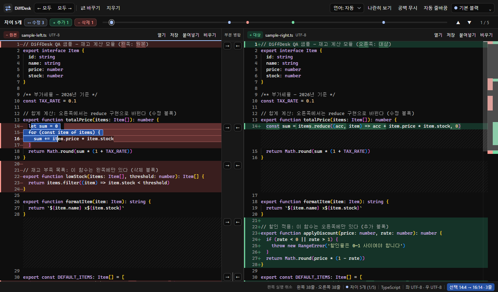

# DiffDesk 블랙 테마·비교 가독성 개선

작업 시작: 2026-10-11. 최종 검증: 2026-10-12. 변경은 작업 폴더에 있으며 커밋하지 않았다.

## 적용 결과

- 기본 다크 및 시스템 다크는 먹색 팔레트의 무채색 블랙 `#0e0e0e`와 차콜 도구줄 `#181818`을 사용한다. CSS 폴백, Monaco, Electron 첫 배경을 맞췄다. 명시적으로 선택한 다른 자체 테마는 유지한다.
- 삭제·변경 전 내용은 코랄, 추가·변경 후 내용은 그린으로 표시한다. 줄 배경과 변경 글자 배경의 강도를 구분하고, 여백의 색상 띠와 `−`/`+` 표시를 함께 사용한다. 전체 줄의 반복 테두리는 줄이고 변경 글자에 얇은 밑선을 둔다.
- 텍스트 선택은 변경 표시와 구분되는 파란 면과 밝은 경계를 사용한다. 선택한 문법 색상은 대비가 확보된 전경색으로 바꾼다. Monaco 0.52의 일반 테마에서 `selectionForeground`만으로는 글자색이 바뀌지 않아 공개 inline decoration API를 사용했다. 상태줄은 선택 양 끝의 행·열과 선택한 줄 수를 표시한다.
- 파일 드롭 대상은 실제 분할 위치를 따라가며 가운데 병합 공간을 침범하지 않는다. 대상 영역의 경계와 가운데 안내 카드를 표시하고, 드래그 취소 시 안내를 제거한다.
- 도구줄·상태 밴드·판 헤더·상태줄은 46/36/36/30px로 정리했다. 좁은 창에서는 보조 상태 정보를 숨겨 선택 범위를 읽을 공간을 확보한다.

[Linear의 2026년 UI 개선](https://linear.app/now/behind-the-latest-design-refresh)의 차분한 도구 영역과 내용 중심 계층, [VS Code의 비교 화면](https://code.visualstudio.com/docs/sourcecontrol/overview)의 버전 구분을 참고했다. 테마 이름·팔레트·정의는 DiffDesk에서 직접 작성했으며 외부 테마 파일을 가져오지 않았다.

## 실제 검증

- 자동 테스트 19/19, renderer·Electron TypeScript 검사, renderer·Electron 빌드, `git diff --check` 통과.
- 네이티브 화면 11개 조건 통과: 기본 블랙 100/125/150%, 먹색·밤하늘·흑연·자주빛·청안개·백지, 기본 라이트, 최소 960×600 창과 모션 감소. 배율은 Windows에서 Chromium device scale factor를 지정했다.
- 실제 마우스 정방향·역방향 드래그, 선택 글자/배경 픽셀, 선택 해제, 양쪽 포커스 이동, 선택 내용 입력·실행 취소, 선택 문서 비우기·재열기, 파일 드롭·취소, 분할선 이동 후 드롭 정렬을 확인했다. 모든 조건에서 도구줄과 상태줄 넘침은 0이었다.
- 기존 기능 검사도 통과: 빈 화면 안내, 파일 드롭, 언어 자동 감지·문법 강조, 부분 병합·실행 취소, 나란히/한 줄 보기 전환, 문서 비우기, Ctrl+F 검색.
- 독립 코드 검토에서 발견한 선택 레이어와 드롭 카드 정렬 문제를 수정한 뒤 화면을 다시 확인했다.

화면 및 조건별 JSON: `2026-10-11-appearance-assets/`.

## Windows x64 배포본

- ZIP: `release/appearance-2026-10-11/DiffDesk-fast-start.zip`
- 크기: 114,684,897 bytes.
- SHA-256: `1bb3775d310af5c01289c23d89f19b3abf0b20891a2193d28047cb626df93149`
- ZIP 무결성 및 실제 압축 해제 통과. 패키지 파일 75개 일치. ASAR의 renderer·Electron 빌드 파일 101개가 현재 빌드와 일치하며 불일치와 앱 QA 스크립트는 0개다.
- 압축 해제한 `DiffDesk.exe`의 PE 아키텍처 x64 확인. 실제 실행·화면 캡처·정상 종료 3/3 통과. 로드 추정 시간 중앙값은 799ms이며, 캡처 대기 2500ms를 포함한 전체 중앙값은 3399ms였다.
- Electron·Chromium 고지를 보존하고 Monaco·React·ReactDOM의 전체 라이선스를 `resources/licenses/`에 포함했다. 원본 라이선스 파일과 바이트 일치를 검사했다.
- `npm run pack`의 Windows x64 ZIP 타깃과 기본 파일명은 유지했다. 이 환경에는 npm 실행 파일이 없어 해당 빌드 단계를 Node CLI로 실행했다. 설치된 Electron과 공식 Windows 도구 캐시를 사용했으며 ZIP·portable 타깃 모두 생성했다.

검증 명령: `node scripts/qa-appearance.cjs`, `node scripts/qa-startup.cjs appearance-dark --smoke --check`, `node scripts/qa-packaged-startup.cjs <압축 해제한 EXE 경로> appearance-zip`.

